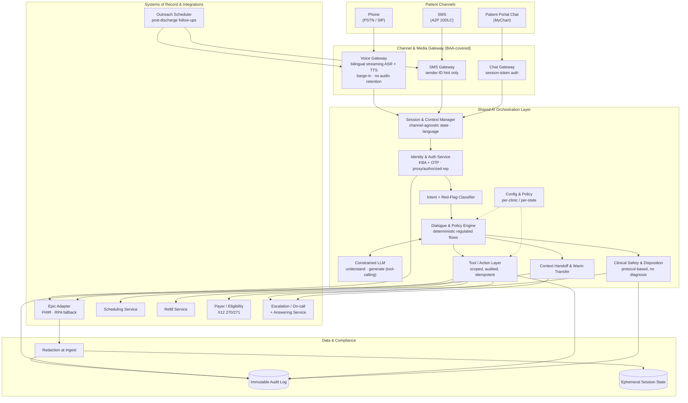

# Larkspur Health — System Architecture Diagram

Linked from `APPROACH.md` § C. All PHI-touching nodes are BAA-covered or self-hosted; no raw audio is retained (Section B: A1–A5, PD1–PD2).

## Legend

- **Channels** normalise into one conversation event model; the orchestration layer is channel-agnostic (Section B: A17, PD12).
- **Identity & Auth** gates every PHI access; caller-ID and self-declared DOB are never sufficient (PD3).
- **Dialogue & Policy Engine** owns regulated flows; the **LLM** only understands and generates language under policy control (A11, PD4).
- **Clinical Safety & Disposition** performs red-flag detection and protocol dispositions, then escalates — it does not diagnose.
- **Epic Adapter** is an abstraction boundary so a FHIR→RPA capability change is config, not a rewrite (A7, PD7).
- **Payer / Eligibility** is shown as deferred/optional until a clearinghouse is confirmed (PD10).
- **Redaction → Audit** ensures only minimised, minimised-at-ingest data is retained; audio is not (A3, PD2, PD9).
